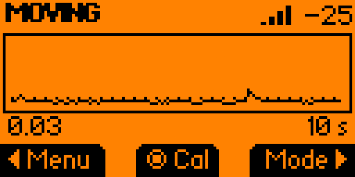
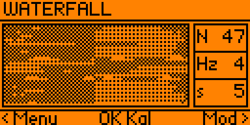
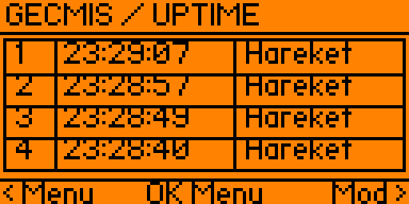

# CSI Radar Ultimate 2.0

Wi-Fi CSI motion monitoring for **Flipper Zero E11 / API 87.1** and the
**official ESP32-S2 Wi-Fi Devboard**. Final feature version of the three-stage
Core → Pro → Ultimate plan. MIT licensed. SauronLAB / Sehmus.

## Features

- Motion/still states, framed 10-second score graph and adjustable threshold.
- Manual start: place the device, then press OK to calibrate.
- Real 47-carrier waterfall, event history and aligned session/diagnostic tables.
- Classic or optional robust filtering; manual or noise-based automatic threshold.
- Masked Wi-Fi setup, profiles, persistent mute/language/settings.
- Queued SD CSV recording, on-device session selection and A/B summaries.
- Explicitly armed alarm with grace/hold/release/repeat and silent monitoring.
- Offline HTML reports, raw-capture waterfall and filter comparison tools.
- Screen backlight stays on while the app is open; normal timeout resumes on exit.

## Quick installation

1. Download the full `flipper-csi-v2.0.0.zip` package and verify `SHA256SUMS.txt`.
2. Keep your existing E11 system firmware; this FAP targets API 87.1.
3. First install or upgrade from 1.5: flash all three `ready/` ESP binaries at the addresses in the guide.
4. Close CSI Radar; copy `ready/csi_radar.fap` to `/ext/apps/GPIO/csi_radar.fap` with qFlipper.
5. Open CSI Radar Ultimate, place it still, then press OK to calibrate. Existing protocol-3 2.0 ESP users can update the FAP alone; the rebuilt ESP only corrects its startup version text.

**[English installation and usage](docs/INSTALL_EN.md)** ·
**[Türkçe kurulum ve kullanım](docs/INSTALL_TR.md)** ·
[Test evidence](docs/BUILD_EVIDENCE.md) · [Device checklist](docs/DEVICE_TESTS_TR.md) ·
[Protocol 3](PROTOCOL.md) · [Changelog](CHANGELOG.md)

## Compatibility and evidence

The owner reports motion/still, vibration, Classic/Robust and automatic/manual
operation, live waterfall and general app operation on the E11 setup, and accepted
the final UI. Version 1.5's checklist was reported all-pass without raw numeric results.
Local builds and host tests are recorded separately from physical reports.

Three-placement accuracy, labeled real capture comparison, 8-hour soak, SD fault
behavior and exhaustive final-2.0 alarm/storage validation have not been independently
verified here. No detection-accuracy percentage is claimed. Other firmware/APIs
require their own build and tests. Do not infer human identity, distance, direction,
count, static presence, breathing or pulse from the score.

## Owner device captures

These are genuine owner-provided screenshots from 2.0 validation. They predate
some final typography/graph-scale changes; they are not generated previews or
proof of long-duration RF accuracy.

## Development

Run `sh tools/run_tests.sh`; use `SANITIZE=1 ASAN_OPTIONS=detect_leaks=0` for the
recorded sanitizer configuration. FAP: ufbt 0.2.6 + Momentum mntm-012 SDK.
ESP: ESP-IDF v5.5, target esp32s2. See the build evidence and manual publication guide.
