# CSI Radar Ultimate

**Wi-Fi CSI motion monitoring for Flipper Zero.**
E11-patched Momentum · API 87.1 · Official ESP32-S2 Wi-Fi Devboard

[](https://github.com/sehmusadsoy-ui/flipper-csi/actions/workflows/ci.yml)


[Install (EN)](docs/INSTALL_EN.md) · [Kurulum (TR)](docs/INSTALL_TR.md) · [2.1 UI notes (TR)](docs/UI_2_1_TR.md) · [Protocol](PROTOCOL.md) · [Changelog](CHANGELOG.md)

An ESP32-S2 listens to your router's Wi-Fi channel state information (CSI) and
turns it into a motion score. The Flipper shows that score live, raises an
optional alarm and keeps a session history on the SD card.

<p align="center">
  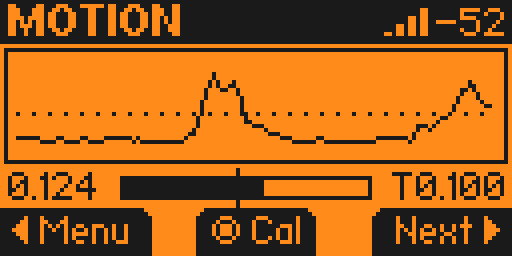
  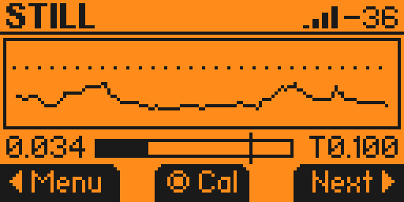
</p>

## What's new in 2.1

| | |
| --- | --- |
| **At-a-glance dashboard** | Large STILL / MOTION banner, inverted while moving and flashing on alarm; score bar with threshold marker |
| **Setup checklist** | Board → Wi-Fi → CSI → Calibrated, with the next step spelled out; progress bar while calibrating |
| **Clearer navigation** | Page numbers (2/6 … 6/6), consistent buttons, center button only when it does something |
| **Recent motion** | Real RTC clock time and duration of each event |
| **Readable diagnostics** | Wi-Fi and calibration codes decoded to text ("Password?", "No AP", "Noisy") |
| **Session saved to SD** | Totals and last 8 events survive closing the app and rebooting the Flipper |
| **Alarm sound** | ~2.5 s rising tone on trigger, plus red LED and double vibration; can be turned off |
| **Motion notify vs. alarm** | Unarmed motion buzz is now its own setting, separate from the armed alarm |

FAP-only update: ESP firmware, protocol 3 and the partition map are unchanged.
2.0 settings files are read as-is.

## Screens

| | | |
| :---: | :---: | :---: |
| 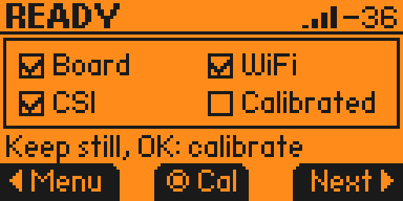<br>Setup checklist | 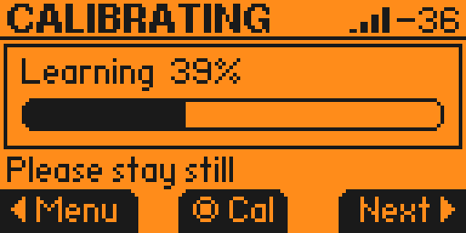<br>Calibration | 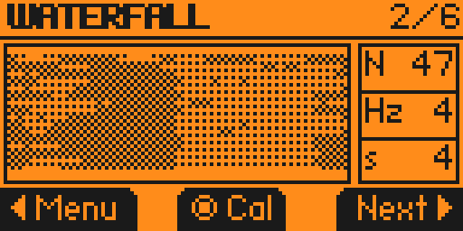<br>47-carrier waterfall |
| 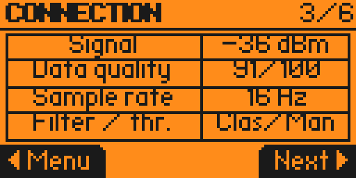<br>Connection | 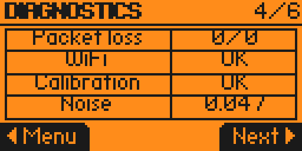<br>Diagnostics | 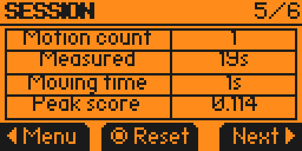<br>Session (restored from SD) |
| 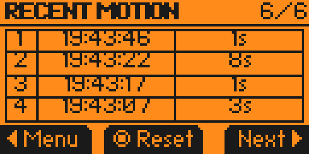<br>Recent motion | 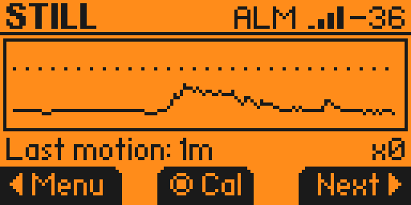<br>Alarm armed | 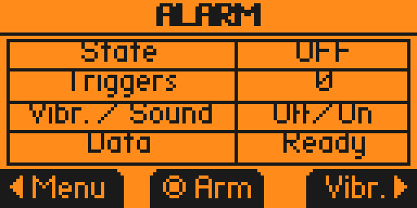<br>Alarm panel |

All screenshots are captured from a real Flipper Zero with live CSI data.
Turkish and English UI are both built in (Menu → Help → Language).

## Controls

| Key | Action |
| --- | --- |
| **Left** | Menu |
| **Right** | Next screen · hold: vibration on/off |
| **OK** | Calibrate (live / waterfall) · Reset (session / history) · Arm/Disarm (alarm panel) |
| **Up / Down** | Adjust threshold (switches to manual) |
| **Back** | Back to dashboard · exit |

## Motion notify vs. alarm

| | Motion notify (unarmed) | Alarm (armed) |
| --- | --- | --- |
| Fires | As soon as the score crosses the threshold | Only after motion lasts the hold time (default 0.5 s) |
| Start delay | none | 0 / 5 / 15 s to leave the room |
| Ongoing motion | once | repeats every 10 / 30 s (or once) |
| Output | single vibration, blue LED | double vibration, red LED, sound, flashing banner, trigger count |

## Install

1. Keep your E11 system firmware. The FAP targets **API 87.1**.
2. **First install or upgrade from 1.x:** flash the three ESP binaries from
   [`ready/`](ready/) as described in the [installation guide](docs/INSTALL_EN.md).
   Coming from 2.0, the ESP does not need to be reflashed.
3. With the app closed, copy [`ready/csi_radar.fap`](ready/csi_radar.fap) to
   `/ext/apps/GPIO/csi_radar.fap` using qFlipper.
4. Open **Apps → GPIO → CSI Radar Ultimate**, set up Wi-Fi from the menu, place the
   device still and press **OK** to calibrate.

Check files against [`SHA256SUMS.txt`](SHA256SUMS.txt). The previous release is
[v2.0.0](https://github.com/sehmusadsoy-ui/flipper-csi/releases/tag/v2.0.0).

## Limits

The score reflects changes in one Wi-Fi link. It does **not** measure direction,
distance, position, people count, static presence or vital signs, and no accuracy
percentage is claimed. Results depend on placement, router traffic and the radio
environment. This is not a certified security alarm. Open hardware checks
(three placements, eight-hour soak, SD faults) are listed in the
[device checklist](docs/DEVICE_TESTS_TR.md). Wi-Fi credential handling is described in
[SECURITY.md](SECURITY.md) and [Wi-Fi storage notes](docs/WIFI_CREDENTIAL_STORAGE_SECURITY.md).

## Build & test

```sh
# Flipper app (ufbt 0.2.6, Momentum mntm-012 SDK, API 87.1)
cd flipper_app && ufbt

# ESP32-S2 firmware (ESP-IDF v5.5)
cd esp32 && idf.py set-target esp32s2 build

# Host tests: motion, protocol, settings, session persistence, alarm, Python tools
SANITIZE=1 ASAN_OPTIONS=detect_leaks=0 sh tools/run_tests.sh
```

Build history and evidence: [docs/BUILD_EVIDENCE.md](docs/BUILD_EVIDENCE.md) ·
[owner test report](docs/OWNER_TEST_REPORT.md).

## Project layout

```
flipper_app/   Flipper FAP (UI, UART protocol, SD storage, alarm)
esp32/         ESP32-S2 CSI capture and motion engine
tools/         Host tests, USB raw capture, replay and HTML reports
ready/         Prebuilt FAP and ESP binaries
docs/          Guides, test reports and screenshots
```

[MIT License](LICENSE) · SauronLAB / Sehmus
